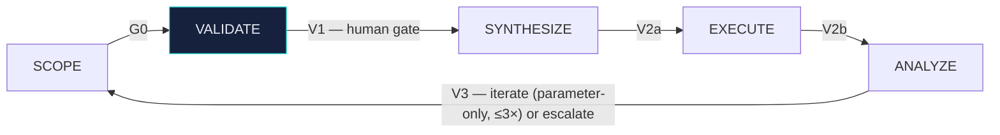
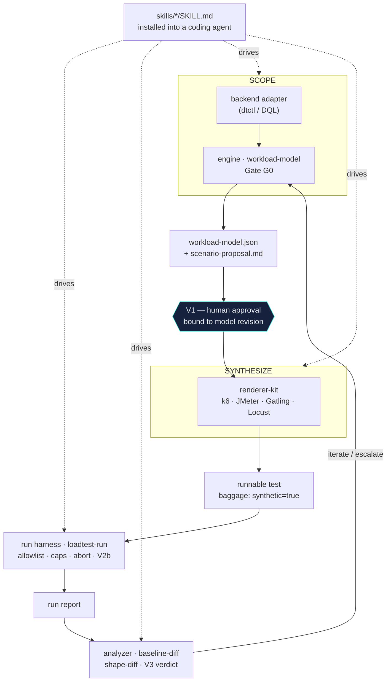

import DemoClip from '@site/src/components/DemoClip';

# How it works

KnightLoad is a five-stage loop. Each stage has one owner and one gate, so you always know
what just happened and what has to be true before the next step runs.

## The loop

<DemoClip name="utility" aspect="800 / 508" caption="The loop in practice: the agent scopes the load-testing profile from your AI assets, you confirm (V1), and the k6 / JMeter scripts are generated." />

| Stage | Owner | Input → Output | Gate |
|---|---|---|---|
| **SCOPE** | you / your agent | clean telemetry window → `workload-model.json` + `scenario-proposal.md` | **G0** extraction self-check |
| **VALIDATE** | **a human, always** | reads the proposal → approval bound to the model revision | **V1** human approval |
| **SYNTHESIZE** | you / your agent | approved model → runnable test + synthetic payload pools | **V2a** static checks |
| **EXECUTE** | you / your agent | small confirmation run, then a capped, abort-guarded full run | **V2b** smoke gate |
| **ANALYZE** | machine + human cap | shape-diff of test vs baseline → accept / iterate / escalate | **V3** tolerance eval |

## One sentence per stage

- **SCOPE.** Query a clean telemetry window and extract the facts a realistic test needs —
  journeys, archetype split, arrival profile, think-times, and payload strategy — into a
  `workload-model.json` stamped with its provenance (`extracted` from your tenant, or
  `demo-sample` — demo data is never silently selectable).
- **VALIDATE.** A human reads the proposal and approves, adjusts, or rejects it — this is
  the gate the whole method exists for.
- **SYNTHESIZE.** Turn the approved model into a runnable, committed test with synthetic
  payload pools — deterministic codegen, never an LLM "generate" prompt.
- **EXECUTE.** Run a small confirmation test first, then a capped, abort-guarded full run
  against a non-production target.
- **ANALYZE.** Shape-diff the test run against the observed baseline and decide: accept,
  iterate, or escalate.

## The V1 human gate

Nothing runs until a person approves it. After SCOPE, KnightLoad stops and shows you a
`scenario-proposal.md`: what it analyzed, the journeys and their weights, the arrival
profile, the payload strategy, where the test will run, and the risks. You approve, adjust,
or reject.

That approval is tied to the exact revision of the model you read. If the model changes
afterward, the approval no longer counts and synthesis refuses to proceed. There is no
agent self-approval and no "approve by telemetry." This one gate is the point of the whole
methodology.

## The components

- **The engine (`workload-model`).** The deterministic core: it runs the extraction,
  clusters journeys, shapes the arrival profile, and self-checks the result with **Gate
  G0** (coverage, per-step evidence source, Little's-Law consistency, a schema-valid
  model). It exits non-zero if G0 fails, so you can gate a pipeline on it. Runs as a
  released binary, a Docker image, or from source.
- **The renderers (`renderer-kit` + the four exporters).** One interface, one model as the
  sole contract. Each renderer turns the approved model into a runnable test for a specific
  tool and declares its approximations up front. See [Exporters](../exporters/index.md).
- **The run harness (`loadtest-run`).** Enforces the non-production allowlist, hard caps,
  automatic abort, and the V2b smoke gate before any full run.
- **The analyzer (`baseline-diff`).** Shape-diffs the run against the baseline across the
  tolerance dimensions and returns the V3 verdict.
- **The skills.** Agent-skill packages (`skills/*/SKILL.md`) you install into a coding agent
  so it can drive the loop in plain language — doing the legwork, never the deciding. See
  [Installing the skills](../get-started/skills-install.md).

## Where the numbers come from (honest about fidelity)

KnightLoad prefers **two sources fused**: spans give trace topology and structure; access
logs (Istio/Envoy sidecar + ingress) give the authoritative, instrumentation-independent
HTTP record and a request-id correlation backbone. For session boundaries, action order,
and think-times it reconstructs sessions from whatever signal is present, in preference
order:

1. **RUM ordered user actions** — richest signal; needs the RUM read scopes.
2. **OTel `session.id` on spans** — Grail-native, app-agnostic, no extra token.
3. **Span-order fallback** — where no session signal exists, and it records the gap.

The model records which source drove each endpoint, so provenance is auditable rather than
blurred. And the caveats are carried openly: extraction is only as good as the telemetry
window you choose, and full session fidelity depends on a session signal being present
end-to-end — where it's sparse, think-times and ordering degrade to span-order assumptions.
That's a known limit, not a hidden one.

## Traffic you can always tell apart

Every generated request carries OTel baggage `synthetic=true`, promoted to a span/resource
attribute so it is queryable. The ANALYZE step uses that filter to separate generated
traffic from the real baseline inside the same environment — your test traffic and your
real traffic never blur.
